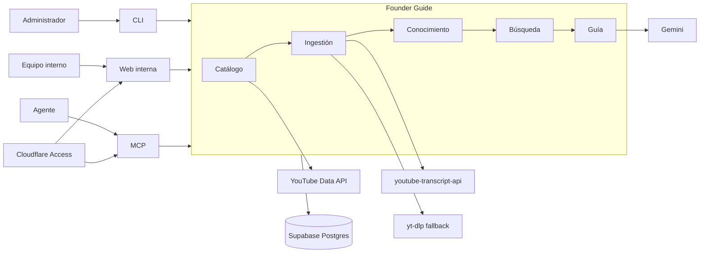
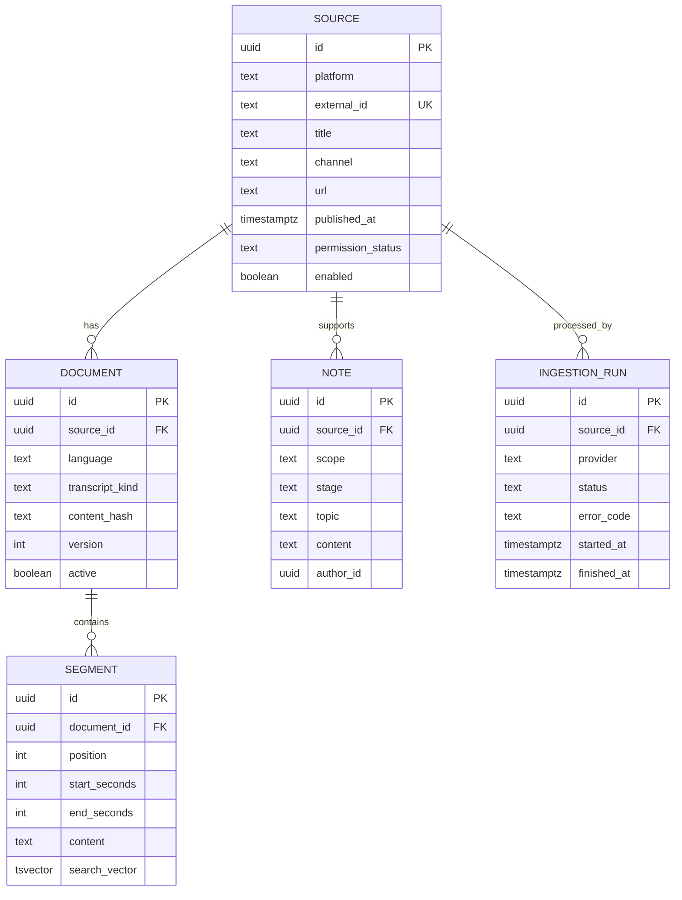

# Founder Guide interno: PRD y arquitectura modular

**Estado:** Propuesto  
**Versión:** 0.1  
**Actualizado:** 2026-07-26  
**Alcance:** Positrónica Labs y Mi Primera Chamba  

## 1. Resumen

Construir una guía interna que convierta contenido público de aceleradoras en
conocimiento consultable, con énfasis inicial en Y Combinator y Platanus. El
sistema debe responder preguntas operativas para ambos equipos con citas al
video y timestamp de origen.

El primer entregable es un slice vertical:

```text
canal de YouTube
  -> catálogo
  -> transcript
  -> segmentos
  -> búsqueda
  -> respuesta citada
```

La arquitectura será un monolito modular. La web, CLI y MCP serán adaptadores
sobre los mismos módulos, no implementaciones separadas.

## 2. Contactos y decisiones

| Rol | Responsable |
|---|---|
| Sponsor y decisión de alcance | Gio |
| Contexto Positrónica | Equipo Positrónica |
| Contexto MPC | Equipo Mi Primera Chamba |
| Aprobación de fuentes y uso interno | Gio |
| Revisión de respuestas | Un responsable por equipo |

Decisiones pendientes antes de producción:

1. Correos permitidos para el acceso interno.
2. Proyecto Supabase que alojará el corpus.
3. Responsable de revisar nuevas fuentes.

Estas decisiones no bloquean el slice local.

## 3. Antecedentes

Positrónica ya tiene captura de conocimiento, Metis, Obsidian y flujos Python.
MPC trabaja con especificaciones vivas, Next.js, Supabase y Gemini. La guía debe
reutilizar esas capacidades sin vivir dentro de ninguno de los dos productos.

Una instalación independiente evita:

- mezclar conocimiento interno con datos laborales o PII de MPC;
- convertir el sitio comercial de Positrónica en infraestructura compartida;
- duplicar ingestión y búsqueda para cada equipo;
- impedir que otro consumidor use el corpus después.

La descarga oficial de captions de videos ajenos no está disponible mediante
YouTube Data API. El sistema usará la API oficial para catálogo cuando exista
una clave, `youtube-transcript-api` para captions y `yt-dlp` como fallback. Cada
fuente tendrá un estado de permiso y el corpus no se publicará.

## 4. Objetivo

Permitir que un integrante de Positrónica o MPC haga una pregunta sobre
validación, producto, ventas, equipo o fundraising y reciba una respuesta útil
con evidencia rastreable.

### Métrica primaria

El 100% de las afirmaciones presentadas como consejo de una aceleradora incluye
al menos una cita con URL y timestamp.

### Criterios del piloto

- 20 videos seleccionados e ingeridos.
- Más de 90% de los videos con captions disponibles se procesan sin edición.
- Un video nuevo queda consultable en menos de 10 minutos.
- Búsqueda p95 menor a 2 segundos con el corpus piloto.
- Reingestar el mismo video no crea duplicados.
- Una respuesta sin evidencia suficiente lo declara, no la inventa.

## 5. Usuarios

### Primario: responsables de producto y operación

Necesitan decidir qué validar, construir o medir a continuación. Quieren una
respuesta corta, evidencia y una acción concreta.

### Secundario: integrantes nuevos

Necesitan aprender el criterio operativo de los equipos sin consumir horas de
video ni depender de una sola persona.

### Administrador del corpus

Selecciona fuentes, ejecuta ingestiones, corrige metadatos y marca contenido
que no debe usarse.

## 6. Propuesta de valor

| Trabajo | Dolor actual | Resultado |
|---|---|---|
| Resolver una duda operativa | Buscar entre videos largos | Respuesta con timestamps |
| Capacitar a una persona | Repetir contexto y criterios | Ruta de lectura verificable |
| Comparar aceleradoras | Consejos dispersos | Coincidencias y contradicciones |
| Aplicar consejo a un equipo | Resumen genérico | Contexto Positrónica o MPC |

El diferenciador no es poseer transcripts. Es conservar procedencia, comparar
fuentes y adaptar el consejo al contexto real de cada equipo.

## 7. Solución

### 7.1 Alcance MVP

Incluye:

- catálogo de videos por canal o lista manual;
- ingestión de captions manuales y automáticos;
- normalización y segmentación con timestamps;
- búsqueda textual;
- notas curatoriales con alcance compartido, Positrónica o MPC;
- respuestas Gemini sustentadas en segmentos recuperados;
- web interna mínima;
- CLI administrativa;
- tres herramientas MCP de solo lectura.

No incluye:

- descargar audio o video;
- transcribir audio con Whisper;
- importar todo el canal de YC;
- publicación de transcripts completos;
- vector database;
- recomendaciones sin fuentes;
- edición colaborativa avanzada;
- analytics de uso;
- billing o acceso público.

### 7.2 Patrón

**Monolito modular Python**, desplegado como un contenedor.

Razones:

- `youtube-transcript-api` y `yt-dlp` son nativos de Python;
- Positrónica ya opera pipelines Python;
- FastAPI cubre web/API;
- el SDK MCP de Python permite añadir el adaptador sin duplicar dominio;
- una sola unidad de despliegue reduce operación.

PostgreSQL será la fuente canónica. Se usará Full Text Search primero.
`pgvector` queda diferido hasta que una evaluación demuestre que FTS no recupera
los pasajes correctos.

### 7.3 Diagrama



### 7.4 Límites de módulos

| Módulo | Responsabilidad | Escribe | Expone |
|---|---|---|---|
| `catalog` | Enumerar videos y metadatos | `sources` | `list_sources` |
| `ingestion` | Obtener, normalizar y segmentar captions | `documents`, `segments`, `ingestion_runs` | `ingest_source` |
| `knowledge` | Reglas de procedencia, notas y scopes | `notes` | `get_source_context` |
| `retrieval` | Filtros, FTS y ranking | nada | `search` |
| `guidance` | Construir respuestas citadas | nada | `answer` |
| `interfaces` | HTTP, web, CLI y MCP | nada | adaptadores |

Regla: los adaptadores no contienen lógica de ingestión, búsqueda o respuesta.

### 7.5 Puertos

```python
class CatalogProvider(Protocol):
    def list_videos(self, channel: str, cursor: str | None) -> Page: ...

class TranscriptProvider(Protocol):
    def fetch(self, video_id: str, languages: list[str]) -> Transcript: ...

class KnowledgeRepository(Protocol):
    def upsert_source(self, source: Source) -> Source: ...
    def replace_segments(self, document_id: UUID, segments: list[Segment]) -> None: ...

class Retriever(Protocol):
    def search(self, query: SearchQuery) -> list[SearchHit]: ...

class Answerer(Protocol):
    def answer(self, question: str, hits: list[SearchHit], scope: str) -> Answer: ...
```

La API oficial y `yt-dlp` implementan `CatalogProvider`.
`youtube-transcript-api` y `yt-dlp` implementan `TranscriptProvider`.

### 7.6 Flujo de ingestión

1. Enumerar videos mediante YouTube Data API.
2. Si no hay clave o falla el catálogo, usar `yt-dlp --flat-playlist`.
3. Intentar caption manual con `youtube-transcript-api`.
4. Intentar caption automático con `youtube-transcript-api`.
5. Si falla, intentar `yt-dlp --write-subs --write-auto-subs`.
6. Si no existe caption, registrar `no_caption` y terminar.
7. Normalizar espacios, etiquetas y repeticiones de captions automáticos.
8. Crear segmentos de 60 a 120 segundos, respetando límites de frases.
9. Calcular hash del transcript normalizado.
10. Hacer upsert por `video_id + language + transcript_hash`.
11. Indexar texto en PostgreSQL FTS.

No se añade Whisper al fallback. Descargar audio agrega costo, tiempo y riesgo.

### 7.7 Invariantes

1. Un segmento no existe sin `video_id`, URL, inicio y fin.
2. Una respuesta no puede citar texto fuera de los hits recuperados.
3. Una fuente deshabilitada no aparece en búsqueda ni respuestas.
4. Repetir una ingestión con el mismo hash no modifica el corpus.
5. Un cambio de transcript crea una nueva versión y desactiva la anterior.
6. Las notas de MPC no aparecen en scope Positrónica y viceversa.
7. El transcript bruto nunca se devuelve completo por API o MCP.

### 7.8 Modelo de datos



Valores iniciales:

- `permission_status`: `unknown`, `internal_reviewed`, `licensed`, `blocked`
- `scope`: configurable via `GUIDE_SCOPES` env (default `shared`)
- `stage`: `idea`, `validation`, `mvp`, `pmf`, `growth`, `fundraising`, `team`

### 7.9 Contratos HTTP

#### Buscar

```http
GET /v1/search?q=hablar+con+usuarios&scope=mpc&stage=validation&limit=10
```

```json
{
  "items": [
    {
      "text": "fragmento",
      "source": {
        "title": "How to Talk to Users",
        "url": "https://youtube.com/watch?v=...",
        "startSeconds": 420
      },
      "score": 0.82
    }
  ],
  "nextCursor": null
}
```

#### Preguntar

```http
POST /v1/answers
Content-Type: application/json

{
  "question": "¿Cómo validamos una oferta piloto?",
  "scope": "shared"
}
```

```json
{
  "answer": "respuesta breve",
  "citations": [
    {
      "sourceId": "uuid",
      "url": "https://youtube.com/watch?v=...&t=420s",
      "startSeconds": 420
    }
  ],
  "insufficientEvidence": false
}
```

#### Ingerir

```http
POST /v1/admin/ingestions
Idempotency-Key: channel-video-language

{
  "videoId": "VIDEO_ID",
  "languages": ["en", "es"]
}
```

Errores:

```json
{
  "error": {
    "code": "NO_CAPTION",
    "message": "No hay captions disponibles para el video."
  }
}
```

### 7.10 MCP

Solo lectura en MVP:

| Herramienta | Entrada | Salida |
|---|---|---|
| `search_founder_knowledge` | query, scope, stage, limit | segmentos citados |
| `get_source_context` | source_id | metadatos y notas |
| `ask_founder_guide` | question, scope | respuesta y citas |

La administración permanece en CLI y HTTP interno.

### 7.11 CLI

```bash
guide catalog-channel https://www.youtube.com/@ycombinator --limit 20
guide ingest-video VIDEO_ID --languages en,es
guide ingest-pending --limit 20
guide retry-run RUN_ID
guide verify-corpus
```

Todos los comandos llaman los mismos casos de uso que HTTP.

### 7.12 Respuesta y citación

1. FTS recupera hasta 12 segmentos.
2. Se limita a 3 segmentos por fuente para evitar una sola voz dominante.
3. Gemini recibe pregunta, scope y segmentos numerados.
4. La salida usa JSON Schema con respuesta, acciones y IDs citados.
5. El servidor rechaza citas que no correspondan a un hit.
6. Si quedan menos de dos segmentos relevantes, responde con evidencia
   insuficiente y devuelve resultados de búsqueda, sin síntesis.

### 7.13 Seguridad

- Aplicación privada detrás de Cloudflare Access.
- Allowlist de correos de ambos equipos.
- Rutas `/v1/admin/*` restringidas a rol administrador.
- Secrets en Doppler o variables de Cloud Run.
- Ningún CV, transcript laboral o dato de usuarios de MPC entra al corpus.
- Logs sin contenido de preguntas, salvo opt-in explícito.
- Backups cifrados de PostgreSQL.

### 7.14 Estructura propuesta

```text
founder-guide/
├── specs/
│   ├── 000-product.md
│   ├── 010-catalog.md
│   ├── 020-ingestion.md
│   ├── 030-retrieval.md
│   ├── 040-guidance.md
│   └── 050-mcp.md
├── adr/
│   ├── 001-modular-monolith.md
│   ├── 002-postgres-fts-first.md
│   └── 003-provider-fallbacks.md
├── src/founder_guide/
│   ├── catalog/
│   ├── ingestion/
│   ├── knowledge/
│   ├── retrieval/
│   ├── guidance/
│   └── interfaces/
├── tests/
│   ├── fixtures/
│   └── acceptance/
├── migrations/
├── Dockerfile
└── pyproject.toml
```

## 8. Release

### Fase 0: contrato y fixtures

- Congelar specs `010` a `040`.
- Guardar un caption manual y uno automático como fixtures.
- Definir la lista piloto de 20 videos.

**Gate:** los criterios SPEC-001 a SPEC-006 son ejecutables.

### Fase 1: slice local

- Ingestar un video.
- Buscar un fragmento.
- Generar una respuesta citada.
- Usar PostgreSQL local o Supabase de desarrollo.

**Gate:** flujo punta a punta y reingestión idempotente.

### Fase 2: corpus piloto

- Enumerar e ingerir 20 videos.
- Añadir scopes y notas de Positrónica/MPC.
- Añadir web interna mínima.

**Gate:** métricas del piloto cumplidas.

### Fase 3: acceso compartido

- Desplegar contenedor.
- Activar Cloudflare Access.
- Conectar Supabase de producción.
- Añadir observabilidad de errores de ingestión.

**Rollback:** deshabilitar respuestas Gemini y conservar búsqueda si las citas
fallan o la tasa de respuestas sin evidencia supera 20%.

### Fase 4: MCP

- Exponer las tres herramientas.
- Validar desde los agentes usados por ambos equipos.

**Gate:** MCP devuelve exactamente las mismas citas que HTTP.

### Después del piloto

Solo con evidencia:

- `pgvector`, si FTS falla una evaluación de recuperación;
- pg-boss o Cloud Tasks, si la CLI ya no alcanza;
- Whisper, si fuentes críticas no tienen captions y existe permiso;
- nuevas aceleradoras, después de estabilizar taxonomía y revisión.

## 9. Especificaciones de aceptación

### SPEC-001: catálogo

**Dado** un canal con videos públicos  
**Cuando** se ejecuta `catalog-channel --limit 20`  
**Entonces** se guardan como máximo 20 fuentes únicas con URL y fecha.

### SPEC-002: fallback de transcript

**Dado** un video sin caption manual y con caption automático  
**Cuando** se ingiere  
**Entonces** el proveedor automático lo procesa y registra su procedencia.

### SPEC-003: idempotencia

**Dado** un video ya ingerido sin cambios  
**Cuando** se ingiere de nuevo  
**Entonces** no se crean documentos ni segmentos adicionales.

### SPEC-004: citas

**Dada** una pregunta con evidencia recuperada  
**Cuando** se genera una respuesta  
**Entonces** cada cita apunta a un segmento recuperado y abre el timestamp.

### SPEC-005: aislamiento

**Dada** una nota con scope `team`  
**Cuando** se busca con scope `private`  
**Entonces** la nota no aparece.

### SPEC-006: evidencia insuficiente

**Dada** una pregunta sin hits relevantes  
**Cuando** se solicita una respuesta  
**Entonces** el sistema marca `insufficientEvidence=true` y no inventa consejo.

## 10. Edge cases

1. Video eliminado o convertido a privado después de ingerirse.
2. Caption automático con frases repetidas o solapadas.
3. Múltiples captions en el mismo idioma.
4. Timestamps ausentes o fuera de orden.
5. Rate limit o bloqueo temporal de YouTube.
6. Cambio del caption sin cambio de metadatos del video.
7. Título o descripción editados.
8. Video sin captions en ningún idioma.
9. Traducción automática disponible pero caption original ausente.
10. Fuente marcada como bloqueada después de haber generado notas.

## 11. ADRs

### ADR-001: monolito modular independiente

- **Estado:** Propuesto
- **Contexto:** dos equipos necesitan el mismo corpus y consumidores distintos.
- **Decisión:** un servicio independiente con módulos internos y un despliegue.
- **Consecuencias:** un repositorio y una operación adicionales, sin acoplamiento
  a MPC o Positrónica.
- **Alternativas:** integrarlo en MPC, descartado por PII y acoplamiento;
  integrarlo en Metis, descartado porque vuelve a Positrónica dueño del runtime.

### ADR-002: PostgreSQL FTS antes de vectores

- **Estado:** Propuesto
- **Contexto:** el corpus piloto es pequeño y las preguntas usan vocabulario
  concreto de startups.
- **Decisión:** `tsvector` y ranking textual.
- **Consecuencias:** menos costo e infraestructura; menor recall semántico.
- **Alternativas:** Chroma y pgvector, diferidos hasta medir recuperación.

### ADR-003: proveedores con fallback

- **Estado:** Propuesto
- **Contexto:** ninguna ruta cubre catálogo y captions de terceros de forma
  completa.
- **Decisión:** API oficial para catálogo, transcript API primaria y `yt-dlp`
  como fallback.
- **Consecuencias:** más tolerancia a fallos; los adaptadores no oficiales
  pueden romperse y requieren revisión.
- **Alternativas:** solo `yt-dlp`, más rápido al inicio pero menos observable;
  solo API oficial, no permite descargar captions ajenos.

## 12. Riesgos

| Riesgo | Impacto | Probabilidad | Mitigación |
|---|---|---:|---|
| Cambio o bloqueo de endpoints no oficiales | Alto | Alta | Adaptadores, fallback y fixtures |
| Uso de contenido sin permiso claro | Alto | Media | Corpus privado, permission status y revisión |
| Respuesta que generaliza una cita | Alto | Media | Validación de citation IDs |
| Consejo viejo | Medio | Alta | Fecha visible y filtro por año |
| Mezcla de contexto entre equipos | Medio | Baja | Scope obligatorio y test SPEC-005 |
| Crecimiento prematuro del stack | Medio | Media | FTS, un contenedor, sin cola en MVP |

## 13. Orden de implementación

1. `SPEC-001`: catálogo de 20 videos.
2. `SPEC-002` y `SPEC-003`: ingestión con fallback e idempotencia.
3. `SPEC-004`: búsqueda y URLs con timestamps.
4. `SPEC-006`: respuesta citada o negativa explícita.
5. Web interna.
6. Scope y notas de ambos equipos.
7. MCP.

El primer commit funcional debe demostrar un video, una pregunta y una cita.
Todo lo demás espera a que ese slice pase.
