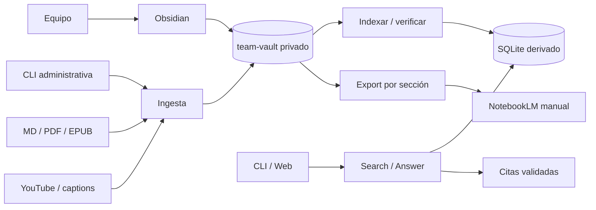
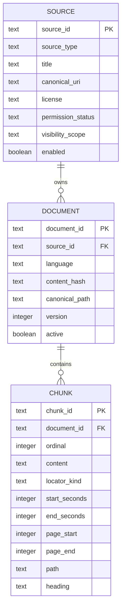

# Team Knowledge: diseño del sistema

Fecha: 2026-08-07

Estado: aceptado para implementación

Decisiones: [ADR-004](../adr/004-private-vault-boundary.md),
[ADR-005](../adr/005-unified-source-and-citation-contract.md)

## Resumen de requisitos

### Funcionales

- Editar y navegar conocimiento en Obsidian.
- Ingerir Markdown primero; PDF y EPUB después mediante adaptadores opcionales.
- Consultar video, libro, nota y Markdown con citas verificables.
- Exportar una sección curada para carga manual en NotebookLM.
- Mantener CLI, HTTP y un MCP futuro sobre los mismos casos de uso.

### No funcionales

- Suite default sin red.
- Reingesta idempotente por hash.
- Cero resultados entre scopes no autorizados.
- Índice local reconstruible desde el vault.
- Ningún binario comprado, secreto o corpus privado en el repo público.
- Corpus piloto pequeño: SQLite y búsqueda lexical son suficientes.

### Restricciones

- Reusar el motor actual y sus SPEC-001 a SPEC-006.
- No añadir embeddings, wiki web, cola, PostgreSQL o automatización no oficial de
  NotebookLM antes de medir una necesidad.
- Un PR lógico menor a 400 líneas cuando sea posible.

## Evaluación actual

Patrón detectado: monolito Python con adaptadores, persistencia write-through y
un `Guide` que concentra los casos de uso. Es adecuado para el equipo y escala
actual, pero el dominio y SQLite están acoplados a `video_id`.

La evolución sigue como monolito modular. No se agregan servicios. Los módulos
nuevos se separan por capacidad y llaman funciones Python, no HTTP interno.

## Diagrama



## Modelo de dominio



`Citation` y `SearchHit` son vistas de `Chunk`, no tablas nuevas. IDs son
deterministas a partir de source, document hash y ordinal para que una reingesta
sin cambios conserve citas.

## Límites de módulos

| Módulo | Responsabilidad | Escribe | Expone |
|---|---|---|---|
| `catalog.py` | Descubrir fuentes externas | nada | sources normalizadas |
| `transcript.py` | Obtener captions | nada | documento con cues |
| `book.py` | Extraer y normalizar MD/PDF/EPUB | nada | documento con bloques |
| `vault.py` | Validar metadata y escribir/leer el vault | vault | documentos canónicos |
| `store.py` | Migrar e indexar proyecciones | SQLite | load, rebuild, verify |
| `query.py` | Filtrar, rankear y validar citas | nada | search, answer |
| `http_api.py` y CLI | Traducir transporte | nada | contratos públicos |

No se reorganiza código existente solo para conseguir este layout. Cada módulo
aparece cuando el primer caso de uso real lo necesita; `__init__.py` conserva
exports compatibles durante la migración.

## Contratos

### Casos de uso

```text
ingest_document(path, metadata, vault_path) -> IngestResult
rebuild_index(vault_path, db_path) -> VerificationReport
search(query, scope, section, source_type, limit) -> list[SearchHit]
answer(query, scope, section, limit) -> Answer
export_notebooklm(section, out, include_private=false) -> ExportReport
```

### CLI

```text
guide ingest-book PATH --book-id ID --section SECTION --license LICENSE --vault PATH
guide rebuild-index --vault PATH --db PATH
guide search QUERY [--scope S] [--section S] [--source-type T] [--json]
guide answer QUERY [--scope S] [--section S] [--json]
guide q QUERY
guide export-notebooklm --section SECTION --vault PATH --out PATH
```

Los comandos actuales permanecen. `q` es alias de `answer`, no otro flujo.

### Cita v1 aditiva

```json
{
  "citationId": "chunk-id",
  "sourceId": "book:mom-test",
  "sourceType": "book",
  "title": "The Mom Test",
  "uri": "01-startup-negocio/mom-test/full.md",
  "locator": {
    "kind": "pages",
    "path": "01-startup-negocio/mom-test/chunks/001.md",
    "pageStart": 12,
    "pageEnd": 14
  }
}
```

Errores mantienen `{ "error": { "code": "...", "message": "..." } }`.
Entradas inválidas fallan antes de escribir vault o índice.

## Persistencia e idempotencia

- `_meta.yaml` y `full.md` son editables; `chunks/` e índice son derivados.
- `source_hash` se calcula sobre contenido normalizado y metadata que cambia la
  interpretación.
- Mismo hash: no-op. Hash nuevo: nueva versión activa, anterior conservada.
- Escritura de vault usa directorio temporal y rename en el mismo filesystem.
- La migración SQLite v1 a v2 corre en una transacción y registra
  `PRAGMA user_version`; las tablas v1 quedan intactas durante una versión.
- Un índice borrado se reconstruye con `rebuild-index` sin red.

Markdown es el primer formato porque no agrega dependencias. PDF y EPUB se
habilitan como extras separados solo con fixtures legales. El chunker prefiere
headings y usa ventanas aproximadas de 3,200 a 4,800 caracteres con overlap de
320; se cambia por tokenizer solo si una evaluación muestra cortes deficientes.

## Dependencias

El runtime actual tiene cuatro dependencias base (`fastapi`, `uvicorn`, `httpx`,
`youtube-transcript-api`) y una extra (`yt-dlp`). No se añade ninguna para el
slice Markdown. PyMuPDF y ebooklib son candidatas opcionales, cada una en su PR.

No hay un ciclo de importación en startup, pero `store.py` hace imports tardíos
de modelos definidos en `__init__.py`; es acoplamiento bidireccional a retirar al
introducir el modelo v2. No se calculó un score numérico ni se revisó frescura de
versiones porque esta entrega no cambia dependencias.

## Riesgos

| Riesgo | Impacto | Probabilidad | Mitigación |
|---|---|---:|---|
| Publicar material privado | Alto | Media | repo privado, `_raw/` ignorado, export fail-closed |
| Fuga entre scopes | Alto | Baja | filtro antes de ranking y pruebas por adaptador |
| Deriva vault/índice | Medio | Media | hashes, verify y rebuild |
| Romper DB piloto | Alto | Media | migración transaccional, v1 conservado |
| Locator inválido | Alto | Media | unión discriminada y validación de cita |
| Dependencia frágil de NotebookLM | Medio | Alta | export manual, sin API en camino crítico |
| Mala extracción PDF/EPUB | Medio | Media | extras opcionales y fixtures por formato |

## Gates del primer hito

1. El vault abre en Obsidian y navega cuatro secciones.
2. Un MD fixture se ingiere dos veces sin duplicados.
3. `search` y `answer` devuelven la misma cita por CLI y HTTP.
4. YouTube conserva URL y timestamp en la API v1.
5. Un scope privado nunca aparece bajo otro scope.
6. Borrar SQLite y ejecutar rebuild conserva citas del fixture.
7. La suite existente sigue verde sin red.
