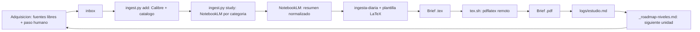

# Capital Cultural Automático

Automatización agnóstica que convierte fuentes de Gemini Notebook en briefs LaTeX y escribe el historial en un vault de Obsidian separado.

## Origen

El proyecto nace de una pregunta concreta: las élites de México y del mundo (ITAM, Colmex, Tec de Monterrey, Oxford PPE, Columbia Lit Hum, LSE, Sciences Po) leen un canon específico que sus miembros asimilan por ósmosis. ¿Se puede adquirir ese capital cultural por cuenta propia, barato y sistemáticamente?

La tesis operativa:

- **El capital cultural es un problema de ingeniería social**: se puede diagnosticar (qué saben, cómo hablan, qué referencias comparten) y atacar con un pipeline.
- **El canon es gratis**: los textos fundacionales están en dominio público, acceso abierto o valen un libro usado. Las élites pagan la credencial, no el contenido.
- **Adaptación del modelo *mingyuan***: las social climbers chinas comparten costos de artículos de lujo para proyectar estatus. Aquí la táctica se aplica al intelecto: crowdsourcing de conocimiento (bibliotecas, Gutenberg, papers abiertos, resúmenes destilados) para adquirirlo de verdad, no solo aparentarlo.
- **Objetivo**: hablar el idioma de cada círculo (VC, economía pública, filosofía, arte, negocio) para abrir puertas: inversiones, clientes de software a medida y proyectos que mejoren el país.

Los códigos de estudio (`vault/_roadmap-niveles.md`) y los planes de estudio verificados (`vault/research/`) documentan el contraste por país y tema.

## Frontera

- Este repo contiene instrucciones, prompts, plantilla e integración.
- `./vault` apunta al contenido personal de Obsidian y está ignorado por Git.
- En otra máquina, crea el enlace o define `CAPITAL_CULTURAL_VAULT` con la ruta del vault.

## Flujo

- Fuentes: Gutenberg, classics.mit.edu, arXiv, PDFs oficiales y lo que cada instalación resuelva en el paso humano. Ver `docs/adquisicion.md`.
- Cada sesión avanza una unidad del roadmap y rota de categoría. El JSON crudo de NotebookLM nunca entra al vault.

## Inicio

1. Lee `AGENTS.md` y `docs/architecture.md`.
2. Elige la siguiente unidad en `vault/_roadmap-niveles.md`.
3. Registra las fuentes en `vault/sources/_catalogo.md`.
4. Sigue `docs/notebooklm-ingestion.md` para cargar fuentes y guardar el resumen.
5. Usa `templates/daily-brief.tex` y `prompts/ingesta-diaria.md` para generar la guía en `vault/outputs/YYYY-Www/`.
6. Compara el PDF con `references/sample-daily-brief.pdf` y actualiza `vault/logs/estudio.md`.

No hay dependencia obligatoria de un agente o proveedor. ZCode, Claude, Codex, Kimi y Grok deben producir los mismos artefactos usando los contratos de archivos.

`docs/setup.md` contiene el arranque para agentes con CLI/MCP y el fallback manual.
