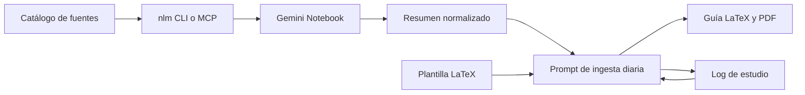

# Arquitectura

## Objetivo

Convertir fuentes fundacionales en aprendizaje acumulativo y material conversacional útil, sin acoplar el flujo a un agente específico ni publicar contenido personal.

## Requisitos

- Cualquier agente local debe poder ejecutar el flujo.
- NotebookLM se consume por CLI o MCP.
- El historial y los documentos generados deben aparecer en Obsidian.
- Git solo versiona automatización, contratos y referencias públicas.

## Evaluación

El sistema es un pipeline local basado en archivos. No necesita API, base de datos, servicio permanente ni arquitectura distribuida. El repo y el vault son dos módulos con propietarios distintos.



## Estructura

```text
~/projects/capital-cultural/
├── AGENTS.md
├── CLAUDE.md
├── README.md
├── docs/
│   ├── adr/
│   ├── architecture.md
│   ├── notebooklm-ingestion.md
│   └── setup.md
├── prompts/
│   └── ingesta-diaria.md
├── references/
│   └── sample-daily-brief.pdf
├── templates/
│   └── daily-brief.tex
└── vault -> ruta local ignorada por Git

vault/
├── README.md
├── _roadmap-niveles.md
├── logs/estudio.md
├── outputs/YYYY-Www/
├── sources/_catalogo.md
└── summaries/<categoria>/YYYY-MM-DD-<tema>.md
```

## Límites de módulos

| Módulo | Responsabilidad | Escribe |
|---|---|---|
| Repo | Reglas, prompts, plantilla e integración | Código y documentación versionable |
| Vault | Biblioteca de trabajo e historial | Fuentes, resúmenes, logs y briefs |
| Gemini Notebook | Procesamiento de fuentes | Respuestas recuperables mediante `nlm` |

No existe API interna. La interfaz son rutas y formatos de archivo. No existe modelo de datos adicional al catálogo y el log Markdown.

## Contratos de archivos

### Catálogo de fuentes

Tabla Markdown en `vault/sources/_catalogo.md`. Columnas: `ID | Categoría | Fuente | Acceso | Estado | Notebook | Archivo o URL | Resumen | impact_score | scored_at`.

- `impact_score`: entero 0-100 que mide el peso académico de la fuente según Paperank. Celda vacía significa `null` (sin score): la fuente aún no se consultó o la API no la encontró. No debe interpretarse como calidad del contenido.
- `scored_at`: fecha ISO del último scoring. Celda vacía = nunca scoreado.
- Los scores se llenan con `tools/score_sources.py` (fail-open: si Paperank falla, la fila queda vacía). La selección de tema en `prompts/ingesta-diaria.md` prefiere la entrada no estudiada con mayor `impact_score`; si todas están vacías rige la rotación base.

### Resumen normalizado

Cada resumen debe incluir: fuente, categoría, nivel, conceptos centrales, vocabulario, tesis, tensiones, ejemplos, citas verificadas y dudas abiertas.

### Salida diaria

Cada ejecución copia la plantilla y sustituye sus marcadores. Produce `YYYY-MM-DD-<tema>.tex` y, si existe un compilador local, `YYYY-MM-DD-<tema>.pdf`. Los auxiliares de LaTeX no se conservan.

### Log

Una fila por sesión: fecha, categoría, nivel, concepto, entrada, salida, comprensión y siguiente paso.

## Ciclo

La rotación base es VC → Institucional → Ivy → Cultural. El log decide el siguiente tema; la fecha solo organiza los archivos. No se crean carpetas semanales fuera de `vault/outputs/`.

## Integración

La frontera con NotebookLM es el ejecutable `nlm`. El flujo usa `notebook create`, `source add --wait` y `notebook query`; un agente que disponga del MCP puede ejecutar las operaciones equivalentes. IDs, rutas y resúmenes quedan en archivos, no en memoria del agente.

Papis o Calibre se incorporan solo cuando el catálogo Markdown deje de ser suficiente. No forman parte del runtime inicial.

## Dependencias

- Requerida: `nlm` para automatizar NotebookLM.
- Opcional: `pdflatex` para compilar localmente.
- Diferida: Papis y Calibre.

## Riesgos

| Riesgo | Mitigación |
|---|---|
| Cambio en la API interna de NotebookLM | Conservar resúmenes locales y usar fallback manual |
| Publicar contenido personal por error | Ignorar `./vault` y revisar el diff antes de cada commit |
| Ruta distinta en otra máquina | Configurar `CAPITAL_CULTURAL_VAULT` o recrear el enlace local |
